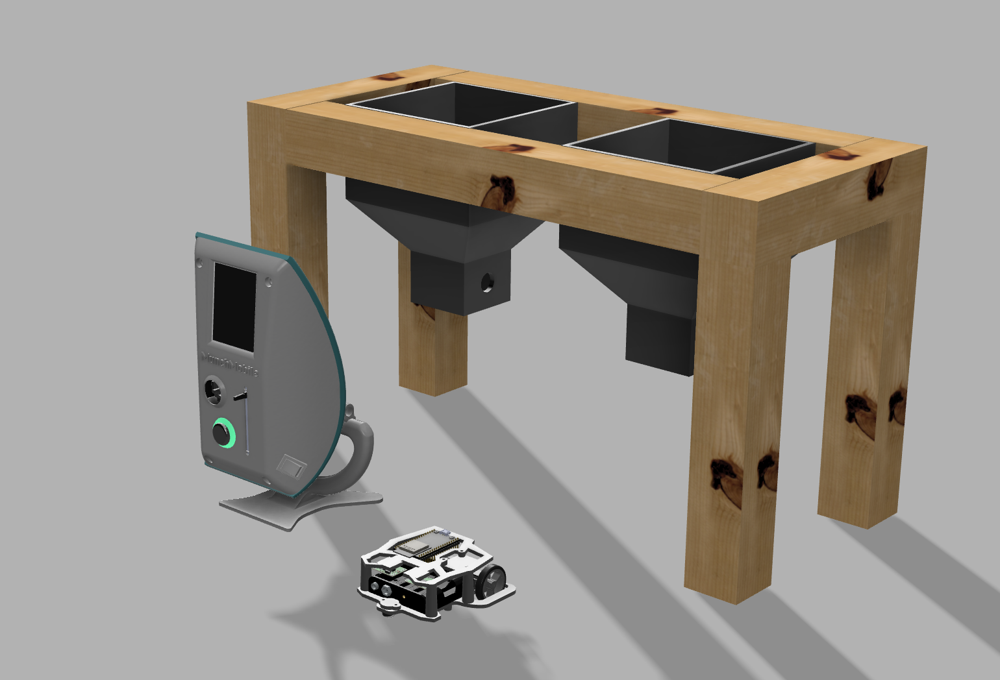
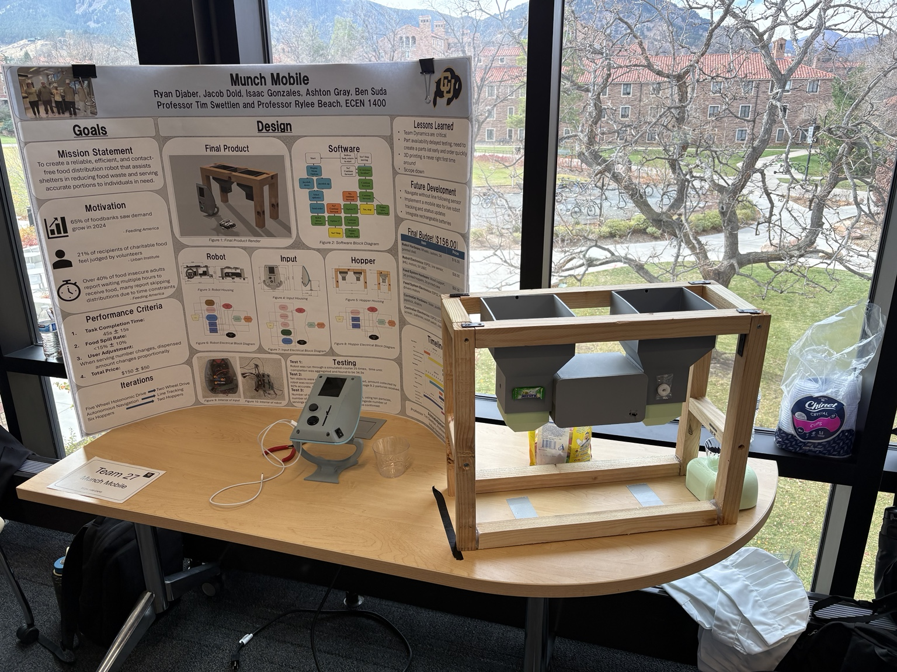
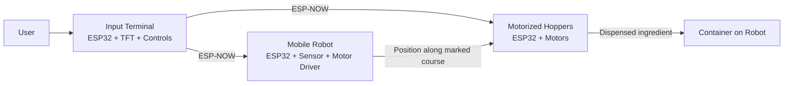
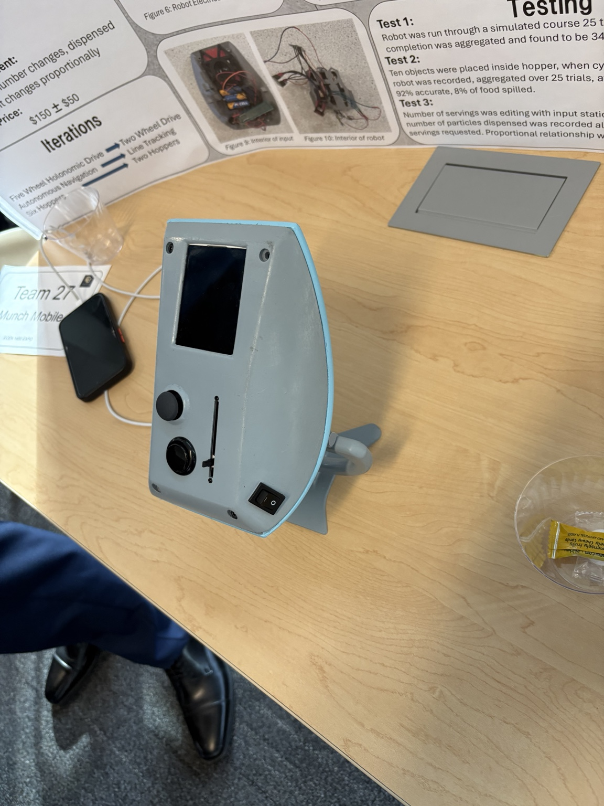
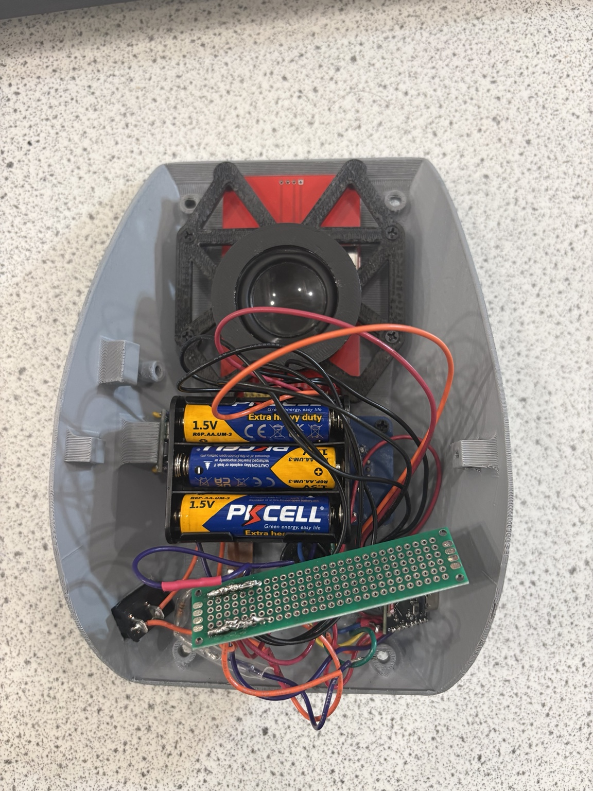
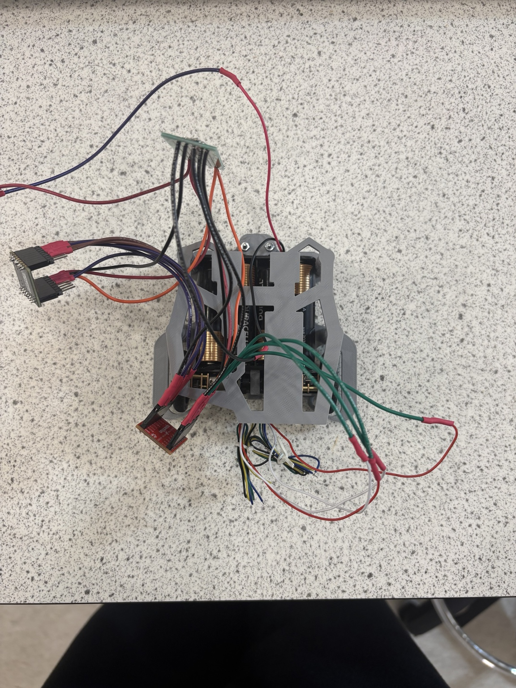

# MunchMobile — Autonomous Food-Dispensing Robot

**An integrated tabletop robotics prototype combining an ESP32-controlled mobile robot, a customizable order terminal, and motor-driven ingredient dispensers.**

Developed by a five-person engineering team for **ECEN 1400 at the University of Colorado Boulder (Fall 2025)**. This repository preserves the team's original firmware, Fusion 360 designs, engineering documentation, expo presentation, prototype photographs, and a demonstration video.



*Final-system CAD render from the original engineering expo poster.*

## Built prototype and demonstration



**[Watch the 26-second expo demonstration](media/video/munchmobile-expo-demonstration.mp4)** — shows operation of the physical input interface and ingredient dispensing during the project expo. The video is a short demonstration, not a complete validation dataset.

## How MunchMobile works

1. The user interacts with a dedicated terminal featuring a TFT display, joystick, pushbutton and adjustable portion control.
2. The terminal's ESP32 sends commands via **ESP-NOW** to the mobile robot and dispensing subsystem.
3. The battery-powered two-wheel robot uses a reflectance sensor and marked path to stop at dispensing locations.
4. Motorized hoppers release selected ingredients into the robot's container.
5. The robot follows its programmed route to finish the delivery sequence.



## Engineering overview

| Subsystem | Implementation |
| --- | --- |
| Mobile platform | Two-wheel drivetrain, rear support, 3D-printed chassis, motor driver and QTR reflectance sensing |
| User interface | 3D-printed housing, ST7789 TFT, joystick, pushbutton, slider/potentiometer and ESP32 controller |
| Dispensing | Two hopper assemblies, motor-driven metering mechanisms and wooden mounting frame |
| Coordination | Distributed ESP32 microcontrollers communicating through ESP-NOW |
| Power | Battery-powered robot and dispensers; separately powered controller/display |
| Design tools | Autodesk Fusion 360, additive manufacturing, circuit assembly, Arduino/C++ |

### Design iteration

The concept evolved from a five-wheel holonomic platform and more extensive hopper network to a **two-wheel, line-guided robot and two-hopper physical prototype**. The team prioritized demonstrable end-to-end operation and reliable communication over the initial autonomous-navigation scope. A communication redesign shifted central command coordination to the input terminal.

## Hardware and editable CAD

The original native Fusion 360 designs are included, not just rendered photographs.

| Design | Fusion source |
| --- | --- |
| Full system | [`cad/full-system/all together.f3z`](cad/full-system/all%20together.f3z) |
| Robot assembly | [`cad/robot/Robot Assembly.f3z`](cad/robot/Robot%20Assembly.f3z) |
| Input terminal | [`cad/input-controller/Casing.f3z`](cad/input-controller/Casing.f3z) |
| Hopper mockup | [`cad/hopper/Hopper Mockup.f3d`](cad/hopper/Hopper%20Mockup.f3d) |

The `.f3z` archives preserve linked Fusion components. Open these files in Autodesk Fusion for editable geometry and assemblies. The primary image above is the original final-system render from the poster.

## Firmware

| Source | Description |
| --- | --- |
| [`firmware/input/InputGame.ino`](firmware/input/InputGame.ino) | User-interface state machine, display rendering, controls and ESP-NOW commands |
| [`firmware/robot/RobotGame.ino`](firmware/robot/RobotGame.ino) | Motor control, QTR reflectance thresholds, stopping logic and ESP-NOW receive callback |

These are the two original sketches available in the archived team code. The hopper-controller firmware is **not included** in the available source snapshot. Its intended behavior is documented in the engineering report and system diagrams; no replacement code has been fabricated.

**Hardware-dependent setup:** The sketches target Arduino-compatible ESP32 boards. To reproduce operation, install the relevant ESP32 board package and display dependencies (`Adafruit_GFX`, `Adafruit_ST7789`), then match the original wiring, peer MAC addresses, ESP-NOW channel and sensor thresholds to the target hardware. The firmware has not been newly re-flashed or bench-tested as part of this repository packaging.

## Prototype photographs

| Input terminal | Interior of terminal |
| :---: | :---: |
|  |  |



*Additional assembly photographs document the real fabricated hardware, not only CAD concepts.*

## Reported testing results

The final engineering report and original expo poster describe repeated prototype testing, including:

| Measurement | Reported outcome | Supporting source |
| --- | --- | --- |
| Robot route trials | 25 trials without recorded mechanical stalls or wheel slippage | Final engineering report, §8.2 |
| Dispensing trials | 25 trials; intended portion matched in 92% of trials, with approximately ±8% variance | Final engineering report, §8.2 |
| Spillage | 8.6% in final report; approximately 8% in poster summary | Final engineering report and expo poster |
| ESP-NOW communications | Over 95% success after communications redesign | Final engineering report, §8.1 |
| Task time | Poster reports 34.5 seconds across 25 course runs; the report describes the same figure differently, so this number is not presented here as a separately verified timing result | Expo poster and final engineering report, §8.1 |

The poster lists the final project budget as **$156**, while the report's bill of materials lists **$166**. Both original source documents are provided below, rather than silently choosing one number.

## Project documentation

- [Final engineering report — DOCX](docs/MunchMobile_Final_Engineering_Report.docx)
- [Expo presentation poster — PowerPoint](docs/MunchMobile_Expo_Poster.pptx)
- [Early project proposal — PDF](docs/MunchMobile_Early_Proposal.pdf)

The report documents the project's design iterations, electrical block diagrams, software flowcharts, mechanical dimensions, fabrication methods, testing and budget. The poster includes the original full-system render, subsystem illustrations, photographs and reported expo results.

## Repository contents

```text
cad/
  full-system/          Full Fusion assembly
  robot/                Robot Fusion assembly
  input-controller/     Input housing Fusion assembly
  hopper/               Hopper Fusion model
firmware/
  input/                InputGame.ino
  robot/                RobotGame.ino
docs/                   Final report, expo poster, initial proposal
media/
  renders/              Poster final-system CAD render
  photos/               Photographs of the physical prototype
  video/                Expo demonstration video
```

## Scope and future work

The completed course prototype relied on marked-path navigation and a two-hopper dispenser system. Planned extensions described in the source documentation include sensor-independent autonomous navigation, rechargeable/docking power, more durable dispensing hardware and a richer user interface. These enhancements are not claimed as implemented in this repository.

## Project team

**University of Colorado Boulder · ECEN 1400 · Fall 2025**

Ryan Djaber · Jacob Dold · Isaac Gonzales · Ashton Gray · Ben Suda

This repository documents the collective team project; it does not assign specific subsystems or authorship to individual team members.
